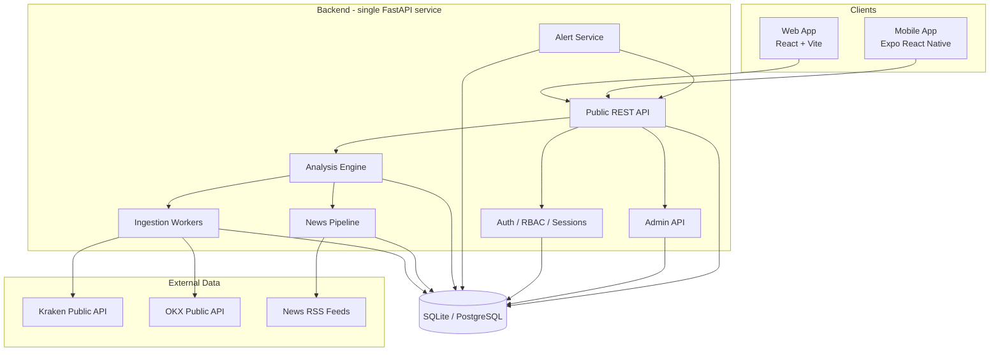

# TrendCipher — Master Architecture

**Status:** Baseline (version 0.1.0)
**Date:** 2026-10-17
**Working name:** TrendCipher (configurable, not final)

---

## 1. Product Vision

TrendCipher is a **cryptocurrency market-intelligence platform** that combines two
information systems into a single explainable analysis product:

1. **News intelligence** — collects cryptocurrency-related news and macro-economic
   events from legitimate free sources, classifies sentiment deterministically,
   attributes relevance to assets, and preserves original source attribution.
2. **Candlestick / technical analysis** — collects market data through documented
   public interfaces, computes deterministic technical indicators, and derives
   price structure.

A **unified analysis engine** combines both evidence streams into conditional,
explainable scenarios (bullish / bearish / neutral) with explicit entry zones,
take-profit targets, stop-loss / invalidation levels, and traceable reasoning.

### Target users

- **Individual crypto analysts and traders** who want explainable, rule-based
  decision support without trusting black-box AI signals.
- **SaaS buyers** who acquire the complete source code, rebrand it, and operate it
  as their own subscription product.
- **Developers** who need a clean, well-documented reference architecture for a
  full-stack crypto intelligence SaaS.

### Commercial objective

The primary deliverable is a **transferable source-code asset** — not a hosted
service. The initial development budget is **$0**. The platform must be valuable
and fully demonstrable even with zero subscribers, zero revenue, no domain, and no
paid subscriptions.

**This is a market-analysis and decision-support platform. It does not execute
trades.** There is no live trading integration.

---

## 2. Major Features and Dependencies

| Feature area | Sub-features | Dependencies |
|---|---|---|
| Marketing site | Landing, methodology, pricing, FAQ, legal placeholders | Web frontend only |
| Market data | Watchlist, OHLCV candles, tickers, multi-timeframe | Market-data provider abstraction |
| News intelligence | RSS ingestion, dedup, classification, asset mapping | News provider abstraction |
| Analysis engine | Deterministic TA + news integration, scenarios, price levels | Both providers, rules engine |
| Historical validation | Reproducible backtests, leakage guards | Market data history |
| Web app | Dashboard, asset detail, charts, scanner, news view | Backend API |
| Alerts | User-configured rules, event triggers, delivery attempts | Backend scheduler |
| SaaS | Users, roles, plans, quotas, admin | Auth + DB |
| Mobile | Android/iOS shared React Native app | Same backend API |
| Push notifications | Device registration, provider abstraction | Expo push / FCM / APNs |

Feature dependencies are strictly top-down: the analysis engine consumes the data
pipeline; the web and mobile clients consume the backend API; the backend is the
single source of truth for all analytical results.

---

## 3. System Architecture

### 3.1 Repository layout (monorepo)

```
trendcipher/
  backend/          # Python FastAPI application (single process)
  web/              # Web frontend (React + Vite + TypeScript)
  mobile/           # Android/iOS (Expo / React Native + TypeScript)
  docs/             # Architecture, user, operator documentation
  scripts/          # Dev/ops helper scripts
  .github/          # CI workflows
  README.md
  HANDOFF.md
```

The repo is a monorepo so a buyer receives one transferable repository.

### 3.2 Components



### 3.3 Data flows

1. **Market ingestion:** A background ingestion loop pulls OHLCV candles and
   tickers from the configured market-data provider (default: Kraken), normalizes
   them into the internal schema, and upserts them into the database. Provider
   failures are non-fatal and logged; stale data is marked, never silently
   substituted.

2. **News ingestion:** A background loop polls configured RSS feeds (default:
   CoinTelegraph RSS, plus others), extracts publication timestamps and URLs,
   deduplicates by canonical URL + fuzzy title, classifies sentiment and asset
   relevance deterministically, and stores source-attributed records.

3. **Analysis:** The analysis engine reads **closed** candles only (never future
   data), computes deterministic indicators and market structure, merges relevant
   news, and produces conditional scenarios with rule-version tags.

4. **Alert dispatch:** The alert service evaluates user alert rules against new
   candles/news/scenarios and records delivery attempts. Push delivery goes
   through an abstraction (Expo Push default at $0).

5. **Client access:** Web and mobile clients only talk to the backend REST API.
   They never call exchange APIs directly for authoritative results.

### 3.4 Single source of truth

The backend is the **only** source of truth for analysis results, alerts, news,
user data, plans, and entitlements. This guarantees web and mobile consistency.

---

## 4. API Contract

### Base URL

- Development: `http://localhost:8000/api/v1`
- Configurable via `PUBLIC_BASE_URL` for deployment.

### Conventions

- REST/JSON. Auth via Bearer token (HTTP-only cookie alternative documented).
- Errors: `{"error": {"code": "...", "message": "...", "details": {...}}}`
- Pagination: `{ "items": [...], "total": N, "limit": N, "offset": N }`
- Timestamps: ISO-8601 UTC.
- Numeric values: decimal strings to avoid float rounding errors on prices.

### Mobile/web consistency

Both clients consume the same endpoints:

| Resource | Endpoints |
|---|---|
| Auth | `POST /auth/register`, `POST /auth/login`, `POST /auth/logout`, `GET /auth/me` |
| Market | `GET /market/tickers`, `GET /market/candles/{symbol}`, `GET /market/symbols` |
| Watchlist | `GET/POST/PUT/DELETE /watchlists` |
| News | `GET /news`, `GET /news/{id}` |
| Analysis | `GET /analysis/{symbol}/scenarios`, `GET /analysis/scenarios/{id}` |
| Alerts | `GET/POST/PUT/DELETE /alerts`, `POST /alerts/{id}/trigger` |
| Notifications | `GET/PUT /notification-preferences`, `POST /devices` |
| Admin | `GET/POST/PUT/DELETE /admin/users`, `/admin/plans`, `/admin/health`, `/admin/settings`, `/admin/audit` |
| Public | `GET /public/marketing/*` (static), `GET /healthz`, `GET /plans` |

### Symbol normalization

Internal canonical symbol format: `<BASE><QUOTE>` uppercase, e.g. `BTCUSDT`,
`ETHUSD`. Provider adapters map their native symbols to the canonical form and
back.

### Timeframes

Canonical interval strings: `1m`, `5m`, `15m`, `30m`, `1h`, `4h`, `1d`, `1w`.
The engine uses `1h` and `4h` by default for scenarios, with configurable
watchlists.

---

## 5. Authentication, Roles, Permissions, Isolation

### Auth

- Password hashing: Argon2id (via `argon2-cffi`).
- Sessions: signed, expiry-bounded JWT access tokens plus opaque refresh token
  stored server-side (revocable).
- `POST /auth/register` creates an ordinary user; the first registered user via
  the bootstrap flow becomes Super Admin (see `SECURITY_AND_PRIVACY.md`).

### Roles (RBAC)

| Role | Privileges |
|---|---|
| `user` | Own data: watchlists, alerts, analysis history |
| `admin` (support/ops) | View user accounts, usage, health; limited admin ops |
| `super_admin` | Everything: plans, settings, users, audit |

All privileged operations are **enforced by the backend**, never by hiding UI
buttons.

### User isolation

Every query that touches user-owned data is scoped by the authenticated user ID.
Cross-user access is rejected (401/403). Authorization checks are unit-tested.

---

## 6. Data-Provider Abstraction

See `DATA_PROVIDERS_AND_LICENSING.md` for full details.

### Market-data interface

```python
class MarketDataProvider(Protocol):
    name: str
    def get_symbols(self) -> list[SymbolInfo]: ...
    def get_tickers(self, symbols) -> list[Ticker]: ...
    def get_candles(self, symbol, interval, start=None, end=None) -> list[Candle]: ...
    def health(self) -> ProviderHealth: ...
```

Each provider adapter declares supported symbols, timeframes, historical depth,
rate limits, timezone, provenance, and licensing status.

### News interface

```python
class NewsProvider(Protocol):
    name: str
    def fetch_latest(self, since) -> list[NewsItemRaw]: ...
    def health(self) -> ProviderHealth: ...
```

### Selected providers (initial)

| Role | Selected | Why |
|---|---|---|
| Market data (default) | Kraken Public REST (`api.kraken.com/0/public/*`) | Geo-accessible from this env, no key needed, 1-min+ OHLC |
| Market data (fallback) | OKX Public API (`www.okx.com/api/v5/*`) | Works, broad symbol set |
| Market data (optional) | Binance / Bybit adapters | Documented but geo-blocked from this env; left as configurable adapters |
| News | CoinTelegraph RSS (+ CoinDesk fallback with redirect handling) | Free, frequent, includes timestamps and URLs |
| Price reference | CoinGecko `simple/price` (optional) | Free, useful for display-only values |

---

## 7. Analysis Methodology

See `ANALYTICAL_ENGINE.md` for full methodology and rules. Summary:

- **Deterministic and testable.** Same inputs → same outputs, always. No embedded
  LLM in the decision path by default.
- **Closed-candle discipline.** Only closed candles enter indicator/scenario
  calculations. The live forming candle is excluded unless explicitly labeled.
- **News is evidence, not truth.** Headlines are never treated as verified facts
  or automatic price predictors.
- **Scenario output** uses explicit decision rules with a **rule version** string
  stored with every scenario, so results are reproducible and auditable.
- **Confidence vs probability.** A 1–100 "alignment score" is not a calibrated
  probability. The product never claims a win rate or expected profitability.
- **Honest non-actionable states.** `NEUTRAL`, `INSUFFICIENT_DATA`,
  `CONFLICTING_EVIDENCE` are first-class scenario states.

---

## 8. Database

Default engine: **SQLite (WAL mode)** for $0 single-machine operation.
PostgreSQL is supported via the same SQLAlchemy models for future buyers.

Core tables:

- `users`, `roles`, `user_roles`
- `sessions`, `refresh_tokens`
- `plans`, `plan_features`, `plan_versions`, `subscriptions`, `payments`
- `watchlists`, `watchlist_items`
- `symbols`, `candles` (OHLCV), `tickers`
- `news_articles`, `news_assets`, `news_metadata`
- `analysis_rules`, `analysis_rule_versions`
- `scenarios`, `scenario_events`, `scenario_price_levels`
- `alerts`, `alert_deliveries`, `devices`
- `audit_events`
- `provider_health`, `ingestion_state`

---

## 9. Notifications Architecture

- User-created **alert rules** (e.g., "price crosses X", "scenario becomes
  BULLISH", "relevance score >= 70").
- Backend **alert evaluator** runs on ingestion/analysis events.
- Delivery through a **notification-provider abstraction**:
  - Default: **Expo Push Service** (free).
  - Adapters: `ExpoPushProvider`, `WebhookProvider`, `LogOnlyProvider`.
- Device tokens are registered by the mobile app via `POST /devices`.
- Duplicate prevention via deduplication keys (`rule_id + event_hash +
  cooldown`).
- Delivery attempts and errors are recorded in `alert_deliveries`.
- **Verification honesty:** real push delivery can only be verified on a physical
  device with valid platform credentials and an Expo development build
  (SDK 53+ requires a dev build, not Expo Go). This is documented; the code and
  setup instructions are delivered regardless.

---

## 10. Plans, Pricing, Entitlements, Payments

- **Plans are database-driven.** Super Admin creates/edits plans via the admin
  dashboard. Prices, intervals, currencies, quotas, and feature flags are stored
  in `plans` / `plan_features`.
- Clients render plans from `GET /plans` — no hardcoded pricing in web or mobile.
- Quotas (watchlists, alerts, etc.) are enforced server-side.
- **Billing-provider abstraction** (`PaymentProvider` protocol). A **demo mode**
  clearly labeled "demo — no real payment" exists for testing. No real gateway is
  integrated by default; a future buyer configures their own credentials.

---

## 11. Security and Secret Management

See `SECURITY_AND_PRIVACY.md`. Summary:

- Secrets only in environment variables / `.env` (never committed; `.env.example`
  ships with placeholders).
- Argon2id password hashing, HTTPS in production, strict CORS, input validation.
- Admin actions audited.
- Sensitive values never logged.
- Dependency license inventory maintained in `docs/architecture`.
- No privileged keys in browser or mobile bundles.

---

## 12. Development, Testing, Deployment, Backup

- Backend tests: `pytest` (unit + API + data integrity + auth + admin).
- Web: `vitest`, React Testing Library, ESLint, TypeScript.
- Mobile: Expo + TypeScript, `jest-expo` where feasible.
- CI: GitHub Actions — lint, typecheck, backend tests, web tests, build.
- Deployment: single-machine `docker compose` (optional) OR plain process server;
  HTTPS via reverse proxy (Caddy/Traefik) configured by the buyer.
- Backup: documented `sqlite3 .backup` procedure; bucket-restore procedure for
  PostgreSQL path.
- Recovery: documented in `docs/` ops guide + `HANDOFF.md`.

---

## 13. Operating Cost Estimates

### $0 development/demo

| Item | Cost | Notes |
|---|---|---|
| Kraken public market data | $0 | Public endpoints, no key (rate limits apply) |
| OKX public market data | $0 | Fallback provider |
| CoinGecko simple price | $0 | Free tier, rate-limited |
| News RSS feeds | $0 | Public feeds |
| SQLite | $0 | Included |
| Expo local dev / push | $0 | Expo Push service free for dev |
| Localhost deployment | $0 | This machine |

### Potential future costs (buyer decides)

| Item | Cost | When needed |
|---|---|---|
| PostgreSQL host (managed) | ~$0–$15/mo | High traffic, HA |
| VPS/host | ~$5–$20/mo | Public SaaS hosting |
| Domain | ~$10/yr | Rebranding |
| Apple Developer ($99/yr) + Google Play ($25 one-time) | NOT wanted | Store publication is out of scope (Expo Go / side-loaded APK instead); only real push on iOS would need it |
| Real payment gateway (Stripe etc.) | fees | Processing real payments |
| Cloud push scale | ~$0 free tier → paid | 10k+ daily pushes |

---

## 14. Ownership Transfer and Handover

Deliverables to the buyer:

- Full monorepo source, architecture docs, migrations, seed scripts.
- `.env.example`, setup guide, deployment guide, backup/restore guide.
- API documentation, provider configuration, mobile build instructions.
- Dependency + license inventory (`DATA_PROVIDERS_AND_LICENSING.md` +
  `docs/licenses/`).
- `HANDOFF.md` as the living handover log.
- No original-owner credentials are embedded. All credentials are placeholders.

---

## 15. Technical Uncertainties and Resolution Method

| Uncertainty | Resolution status |
|---|---|
| Binance/Bybit geo-blocked from dev env | Documented; adapters written but default to Kraken/OKX |
| Binance commercial redistribution restrictions | Documented; product uses Kraken/OKX by default |
| Real push delivery unverifiable without physical device | Documented; provider abstraction + setup guide shipped |
| Real payment processing | Out of scope for $0; abstraction + demo mode |
| Historical news archives | Free RSS only covers recent posts; documented limitation |
| Long-term rate limits / throttling | Documented per provider; adapters enforce backoff |

---

## 16. Phased Roadmap

See `IMPLEMENTATION_ROADMAP.md`. Summary:

1. Repository & foundation
2. Real data pipeline
3. Analytical engine
4. Functional web product
5. SaaS + Super Admin
6. Android/iOS + push
7. Validation & handover

Each phase has acceptance criteria and is tracked in `HANDOFF.md`.

---

## 17. References (checked 2026-10-17)

- Kraken REST public market data: https://docs.kraken.com/api/docs/rest-api/public/get-ohlc (accessed 2026-10-17)
- Bybit API v5 docs / rate limits: https://bybit-exchange.github.io/docs/v5/rate-limit
- Binance Developer docs / Terms: https://developers.binance.com/en/docs/products/spot/rest-api
- OKX V5 API docs: https://www.okx.com/docs-v5/en/
- CoinGecko API: https://docs.coingecko.com/reference/simple-price (public demo endpoints)
- TradingView Lightweight Charts (Apache-2.0): https://github.com/tradingview/lightweight-charts
- Expo Notifications: https://docs.expo.dev/versions/latest/sdk/notifications
- CoinTelegraph RSS: https://cointelegraph.com/rss (verified reachable 2026-10-17)
- CoinDesk RSS: https://www.coindesk.com/arc/outboundfeeds/rss/ (308 redirect observed; adapter handles redirects)

*All API endpoints referenced above were tested from the development environment
on 2026-10-17 unless otherwise noted.*